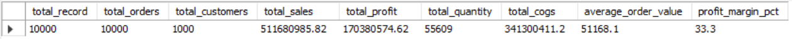
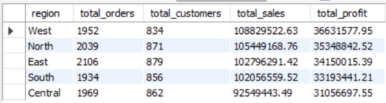

# Business Sales Analysis & Performance Dashboard

## Project Overview

The **Business Sales Analysis & Performance Dashboard** is a data analytics project developed using Python, SQL, and Power BI. The project analyzes 10,000 sales transactions to understand business performance, identify sales trends, evaluate product profitability, and generate meaningful business insights.

The project includes data cleaning and exploratory data analysis in Python, business-focused SQL queries in MySQL, and an interactive Power BI dashboard for visualizing key performance indicators.

## Tools & Technologies

- **Python:** Pandas, NumPy, Matplotlib, Seaborn
- **SQL:** MySQL
- **Data Visualization:** Microsoft Power BI
- **Development Environment:** Jupyter Notebook, MySQL Workbench
- **Version Control:** Git and GitHub

## Dataset Overview

The dataset contains 10,000 sales transaction records with information about:

- Transaction date and time
- Customer and product details
- Product category and region
- Sales channel and payment method
- Quantity and unit price
- Discounts, total sales, and cost of goods sold (COGS)
- Profit and other business metrics

The dataset was cleaned and processed before being used for further analysis.

## Project Workflow

### 1. Python Data Analysis

- Loaded and explored the raw sales dataset.
- Checked data quality, missing values, and duplicate records.
- Performed data cleaning and preprocessing.
- Created additional features for time-based and profitability analysis.
- Exported the cleaned dataset for SQL analysis and Power BI reporting.

### 2. SQL Analysis

Used MySQL to answer business questions through queries covering:

- Overall sales and profit performance
- Monthly sales and profit trends
- Category and product performance
- Regional sales performance
- Sales channel analysis
- Top 10 products by sales and profit
- Top 10 customers by sales
- Payment method analysis
- Discount impact analysis

SQL query outputs are included in the project screenshots.

### 3. Power BI Dashboard

Created an interactive dashboard to monitor business performance using KPI cards, charts, and filters.

**Key dashboard metrics:**
- Total Orders
- Total Sales
- Total COGS
- Total Profit
- Total Quantity Sold
- Profit Margin

**Dashboard visualizations:**
- Monthly sales trends
- Top-performing products
- Salesperson profit comparison
- Sales channel performance
- Regional profit analysis
- Category and payment method analysis
- Interactive slicers for exploring sales data

## Key Business Metrics

| Metric | Result |
|---|---:|
| Total Transactions / Orders | 10,000 |
| Total Sales | 511.68 Million |
| Total Profit | 170.38 Million |
| Unique Customers | 1,000 |

*Note: Financial values are presented in the dataset's currency units.*

## Project Screenshots

### Power BI Dashboard


### SQL Query Outputs

**Overall Business Performance**



**Monthly Sales and Profit Trend**


**Category and Product Performance**


**Regional Performance**



*Ensure each image filename matches the actual file in your repository.*

## Project Structure

```text
Business-Sales-Analysis/
├── data/
│   ├── raw/
│   │   └── Sales_Data.csv
│   └── processed/
│       └── Sales_Data_Cleaned.csv
├── python/
│   └── Sales_Analysis.ipynb
├── sql/
│   └── Sales_Analysis.sql
├── powerbi/
│   └── Business_Sales_Dashboard.pbix
├── images/
│   ├── powerbi/
│   │   └── sales_dashboard.png
│   └── sql/
├── README.md
└── requirements.txt
```

## Business Value

This project demonstrates how data analytics can support business decision-making by helping users:

- Track sales and profitability.
- Identify high-performing products and regions.
- Understand customer purchasing patterns.
- Compare sales channels and payment methods.
- Monitor monthly business performance.
- Explore business KPIs through interactive reporting.

## Skills Demonstrated

Python, Pandas, NumPy, Exploratory Data Analysis (EDA), Data Cleaning, Feature Engineering, SQL, MySQL, Power BI, Data Visualization, Dashboard Development, and GitHub.

## Future Improvements

- Develop sales forecasting using machine learning.
- Add customer segmentation and deeper customer analysis.
- Automate data refresh and reporting.

**Data Analytics Portfolio Project**

Developed to demonstrate practical skills in Python, SQL, and Power BI for business data analysis.
